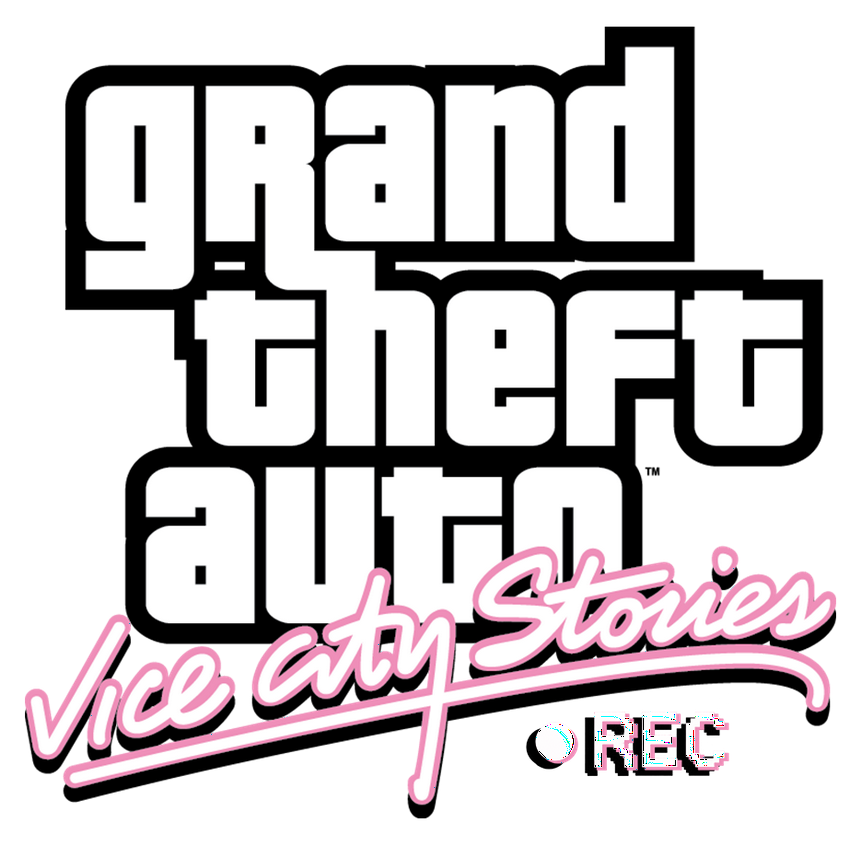
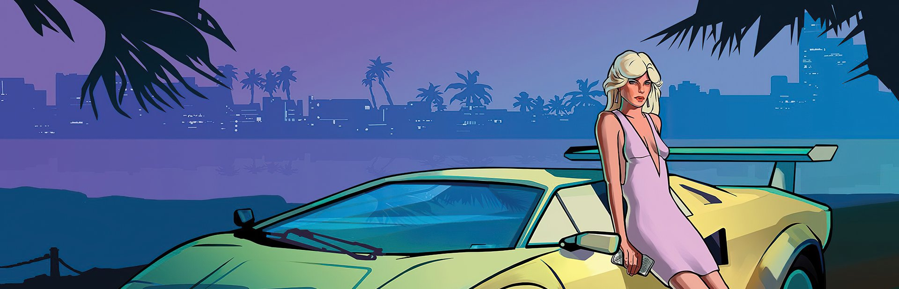

<div align="center">



### GTA Vice City Stories.REC — Native PC Port (PS2 · SLUS-21590 USA)

[](https://github.com/willzmkv/gta-vcs-recomp/releases/latest)
[](https://github.com/willzmkv/gta-vcs-recomp/releases/latest)
[](docs/NATIVE_RENDERER.md)
[](LICENSE)
[](https://livepix.gg/willzmkv)

<br />



<br />

[Download & Play](#-download-and-play) ·
[What This Fork Adds](#-what-this-fork-adds) ·
[Bundled Mods](#-bundled-mods--mod-loader) ·
[Port Features](#-core-features) ·
[Controls & Keys](#-in-game-shortcuts) ·
[Troubleshooting](#-troubleshooting) ·
[Build from Source](#-building-from-source)

</div>

---

**GTA Vice City Stories.REC** is a native PC port of **Grand Theft Auto: Vice City Stories** (PS2, USA `SLUS-21590`), created by statically recompiling the game's PS2 executable into C++ and rendering it natively on Direct3D 12, Direct3D 11, or Vulkan.

This fork builds on [gothamor/gta-vcs-recomp](https://github.com/gothamor/gta-vcs-recomp), keeping its upstream fixes while adding a dedicated Vice City launcher, **Detailed City Distance (HD World)**, extended view & population sliders, **Distant Traffic & Crowds**, a live **Mod Loader** with bundled mods, **Oswald SemiBold subtitles**, **Kenney button prompts**, and a **Miami Vice** in-game UI.

> [!IMPORTANT]
> **No game code or copyrighted game data is included in this repository.**
> You must supply your own **USA (`SLUS-21590`)** disc image (`.iso`) or PS2 DVD. The launcher compiles the game locally on your PC from this source and your disc, and streams assets from your disc while playing.

---

## 🚀 Download and Play

### Requirements (Windows)
| Component | Requirement |
|---|---|
| **OS** | Windows 10 or 11 (64-bit) · *Linux AppImage also published (experimental)* |
| **CPU** | Any x86-64 processor with **SSE4.2** (AVX2 builds a faster binary) |
| **RAM** | 8 GB or more |
| **GPU** | Direct3D 12 (default), Direct3D 11, or Vulkan |
| **Storage** | ~6 GB free space (short local path like `C:\Games\VCS` — avoid `Program Files` or OneDrive) |
| **Disc** | Your own **USA (`SLUS-21590`)** `.iso` or PS2 DVD |

### Quick Start
1. Download **`VCS.rec-Launcher-<version>.exe`** (standalone all-in-one executable) or **`VCS-Recomp-<version>-windows.zip`** from [**Releases**](https://github.com/willzmkv/gta-vcs-recomp/releases/latest).
2. Run the launcher — it guides you step by step:
   - **Folder** — verifies path and disk space.
   - **Disc** — drag & drop your `.iso`, browse for it, or rip directly from a DVD drive.
   - **Build tools** — downloads the compiler automatically (~190 MB, once — no Visual Studio required).
   - **Build** — compiles the optimized game for your CPU (**30–60 min** on the first build; future updates take a few minutes).
3. Press **Play**.

> [!TIP]
> Saves are stored in `%LOCALAPPDATA%\VCSRecomp` (and backed up automatically before overwrites). Use the launcher's **Saves** tab to create or restore backups anytime.

### Updating
Open the launcher and click **Settings → Updates → Update now** (available in **English** and **Português**). Saves and settings are never touched.

- **`1.0.x`** — bug fixes and polish
- **`1.x.0`** — upstream [gothamor/gta-vcs-recomp](https://github.com/gothamor/gta-vcs-recomp) merges
- **`x.0.0`** — major milestones of this fork

---

## ✨ What This Fork Adds

The original PS2 look is always the baseline — every enhancement is optional, and choosing **Original (PS2)** in the graphics presets restores authentic PS2 visuals.

<table>
<tr>
<td width="50%" valign="top">

### 🌴 Dedicated Launcher
- Setup, build, play, updates, saves and bug reports in one Vice City-styled window.
- **Hardware-aware graphics presets** (*Original (PS2)*, *Low*, *Medium*, *High*, *Vice Ultra*) auto-selected for your PC on first install.
- Interactive controller diagrams (**DualShock 2, Xbox, DualShock 4, DualSense, Switch Pro**) & keyboard/mouse layouts (Classic PS2 or Modern triggers).
- **Shader warm-up** before launch to eliminate first-draw stutters.

</td>
<td width="50%" valign="top">

### 🏙️ HD World & Population
- **Detailed city distance:** draws full-detail buildings hundreds of metres out instead of low-detail LODs, with mission building switches preserved.
- **Distance & density sliders:** scale view distance, LODs, vehicles and pedestrians up to 10× / 4×, with dynamic frame-rate thinning.
- **Distant traffic & crowds:** real vehicle and walker models on far roads and pavements beyond the simulated bubble.
- **Crowd bands** *(experimental)*: seamless handover between far walkers and real pedestrians.

</td>
</tr>
<tr>
<td width="50%" valign="top">

### 🎨 UI, Subtitles & Prompts
- **Miami Vice in-game menus:** **F2** settings menu and **F5** trainer restyled to match the launcher.
- **Oswald SemiBold subtitles & help boxes:** crisp sub-pixel spacing with size, outline, shadow, background and colour options.
- **Portuguese font support:** native in-game fonts render `Ã`, `ã`, `Õ`, `õ` cleanly in mission titles and banners.
- **Kenney's Input Prompts:** sharp icons for PlayStation, Xbox, Nintendo Switch and keyboard that match your active control scheme and translated discs.

</td>
<td width="50%" valign="top">

### ⚡ Graphics & Performance
- **Direct3D 12** by default (D3D11 and Vulkan selectable in **F2 → Graphics**) for lower CPU overhead and smoother frametimes.
- **Expanded streaming memory** (**F2 → Game → Memory**) for heavy mod packs and greater vehicle variety.
- **Custom fog distance** slider and VRAM-budgeted texture pack cache.
- **Cutscene polish:** PS2 cutscene framing option (**Display → Screen**), fixed fade-in skies, and detailed city kept in outdoor cutscenes.

</td>
</tr>
</table>

---

## 📦 Bundled Mods & Mod Loader

Drop any mod into its own folder inside `modloader/` and toggle or reorder it **live** in **F2 → Mods** ([docs/MODS.md](docs/MODS.md)).

### Included out of the box
| Mod | What it adds |
|---|---|
| **HD Hands** | Cutscene-quality articulated hands grafted onto **all 14 of Vic's outfits** |
| **HD Hud** | Sharper HUD, radar and weapon icons remastered for high resolutions |
| **PT-BR (VCS.rec)** | Brazilian Portuguese translation ready to toggle on/off in **F2 → Mods** |

### Supported PC & PS2 mod formats
- **Texture Packs:** PCSX2-style DDS (BC7) or PNG replacement packs ([docs/TEXTURE_PACKS.md](docs/TEXTURE_PACKS.md)).
- **PC Vice City Vehicles:** drop `.dff` + `.txd` files to replace cars, bikes, boats and helicopters automatically.
- **PC Weapon Mods:** Vice City & San Andreas weapon models with proper VCS hand placement and HUD icons.
- **Game File Overrides:** replace models, textures, `MAIN.SCM`, or GXT text files without touching your `.iso`.

---

## 🎮 Core Features

- **High Frame Rates:** 60 fps default with frame-rate independent timing — supports 30 (PS2), 60, 100, 120, 144, 165, 240, display refresh, or uncapped, with V-Sync / G-Sync / FreeSync support. Vehicle physics, mission timers, particles, weather and effects stay faithful at any FPS.
- **Hor+ Widescreen & Ultrawide:** 16:10, 16:9, 21:9, 32:9 or arbitrary window sizes with zero stretching, plus configurable HUD placement (4:3 centred, screen edges, or stretched).
- **Resolution & AA:** internal scaling from 1× (640×448) up to 8× or native window resolution, up to 8× MSAA and 16× anisotropic filtering.
- **Modern Controls ([docs/CONTROLS.md](docs/CONTROLS.md)):** seamless keyboard + mouse + gamepad mixing, mouse look & free aim, full key rebinding, rumble, and **DualSense adaptive triggers & light bar**.
- **Audio:** independent master, music, SFX and movie sliders; stereo/mono/swapped output; background mute/pause options.

---

## ⌨️ In-Game Shortcuts

| Key | Action |
|---|---|
| **F2** *(or Back + Start)* | Settings menu (Graphics, Distance & Population, Controls, Sound, Mods — saved in `vcs.ini`) |
| **F3** | Performance & game-state overlay |
| **F4** | Record performance telemetry to CSV |
| **F5** | Built-in Trainer ([docs/TRAINER.md](docs/TRAINER.md)): god mode, wanted level, money, weapons, vehicles, teleports, mission launcher, time & weather |
| **F8** | Capture screenshot to `screenshots/` |
| **Alt + Enter** | Toggle borderless fullscreen / windowed |

---

## 🛠️ Troubleshooting

<details>
<summary><b>Click to expand common issues & fixes</b></summary>

<br />

| Symptom | Fix |
|---|---|
| Launcher says the disc is another release | Only the **USA (`SLUS-21590`)** release is supported. |
| First build fails while downloading | Check your internet connection and click **Try again** — it resumes where it left off. |
| Step fails immediately with `0xC000001D` | Binary was built for a newer CPU instruction set — rebuild from the launcher on this PC. |
| Files "dated in the future" / `build.ninja still dirty` | Sync your Windows clock / time zone and build again. |
| `vcs.exe` does nothing when launched directly | Launch via `VCSLauncher.exe`, or set `iso=C:\path\to\your.iso` in `vcs.ini` next to `vcs.exe`. |

Use **Help → Make a report** inside the launcher to bundle logs safely (no game files or saves), and open an issue in [**Issues**](https://github.com/willzmkv/gta-vcs-recomp/issues).

</details>

---

## 🧑‍💻 Building from Source

<details>
<summary><b>Click to expand CLI build instructions & developer commands</b></summary>

<br />

Requires **Python 3** and **Git** (the launcher drives these exact scripts):

```bash
git clone https://github.com/willzmkv/gta-vcs-recomp.git vcs-recomp
cd vcs-recomp
python tools/doctor.py                    # checks folder, compiler, disc and build state
python tools/build.py --recompile [ISO]   # disc -> C++ -> optimised game (ThinLTO)
python tools/run.py 0                     # launch the game (logs to build/run/run.log)
```

After `git pull`, run `python tools/build.py --recompile-if-needed`.

| Command | Purpose |
|---|---|
| `python tools/build.py --quick` | Fast unoptimised build for development (kept until `--opt lto`) |
| `python tools/build.py --opt lto` | Full ThinLTO release build (default) |
| `python tools/build.py --launcher` | Build `VCSLauncher.exe` in the repo root |
| `python tools/build_dir.py set PATH` | Redirect build output to another directory |
| `python tools/backup.py create\|list\|restore` | Manage memory card backups |
| `python tools/release.py` | Package release zip / AppImage (refuses game files) |

See [AGENTS.md](AGENTS.md) for contributor rules and [docs/](docs/) for internals ([docs/game-internals.md](docs/game-internals.md)) and roadmap ([docs/FORK.md](docs/FORK.md)).

</details>

---

## ☕ Support the Project

This fork is developed and maintained in free time. If **GTA Vice City Stories.REC** brought you good memories and you'd like to support future updates, you can contribute via **LivePix**:

<div align="center">

[](https://livepix.gg/willzmkv)

<br />

<a href="https://livepix.gg/willzmkv">
  
</a>

*Scan the QR code or click the button above to support via LivePix.*

</div>

---

## 💖 Credits & License

- **Fork, Launcher, HD World, HD Hands & HD Hud:** [willzmkv](https://github.com/willzmkv)
- **Base Native Port & Recompiler:** [gothamor/gta-vcs-recomp](https://github.com/gothamor/gta-vcs-recomp), built on [PS2Recomp](https://github.com/ran-j/PS2Recomp)
- **Button Prompt Icons:** [Kenney Input Prompts](https://kenney.nl/assets/input-prompts) (CC0)
- **License:** [GPL-3.0](LICENSE) (inherited from PS2Recomp)

*Grand Theft Auto, Vice City Stories, and all game assets are trademarks and property of Rockstar Games / Take-Two Interactive. This project contains no copyrighted game files.*

<br />

<div align="center">
  
</div>
